# ADE Platform Setup — Complete Guide

> **For this hardened package:** the original guide is preserved below. Current
> deployment commands are in the [new security-hardening guide](#current-hardened-deployment-guide).
> Run `./validate.ps1` for local checks, or `./validate.ps1 -Offline` after providers
> have been initialized. The package includes its own `azure-pipelines.yml` for
> validation when published as a standalone repository.

> **What is this project?**
> This repository contains everything needed to automatically deploy a fully isolated cloud data platform on Microsoft Azure — including networking, databases, data storage, a Databricks analytics workspace, an App Service API, and a container registry. Each deployment creates a completely self-contained environment for one client + environment combination (e.g. `apple-dev1`, `disney-prod`). All infrastructure is defined as code using **Terraform** and is deployed automatically via **Azure Deployment Environments (ADE)**.

---

## Table of Contents

1. [Project Overview](#1-project-overview)
2. [Architecture Explanation](#2-architecture-explanation)
3. [What Gets Deployed](#3-what-gets-deployed)
4. [Naming Convention](#4-naming-convention)
5. [Prerequisites — What You Need Before Starting](#5-prerequisites--what-you-need-before-starting)
6. [Azure Account Requirements](#6-azure-account-requirements)
7. [Required Permissions and IAM Roles](#7-required-permissions-and-iam-roles)
8. [One-Time Platform Setup (Do This Once)](#8-one-time-platform-setup-do-this-once)
   - [8.1 Install Required Software](#81-install-required-software)
   - [8.2 Azure CLI Setup](#82-azure-cli-setup)
   - [8.3 Terraform Installation](#83-terraform-installation)
   - [8.4 Service Principal Creation](#84-service-principal-creation)
   - [8.5 Platform Key Vault Setup (kv-adenv)](#85-platform-key-vault-setup-kv-adenv)
   - [8.6 Terraform State Storage Account](#86-terraform-state-storage-account)
   - [8.7 Register Azure Resource Providers](#87-register-azure-resource-providers)
9. [Repository Setup](#9-repository-setup)
   - [9.1 How to Clone the Repository](#91-how-to-clone-the-repository)
   - [9.2 Folder Structure Explained](#92-folder-structure-explained)
   - [9.3 Terraform Module Reference](#93-terraform-module-reference)
10. [Azure Deployment Environments (ADE) Setup](#10-azure-deployment-environments-ade-setup)
    - [10.1 What is ADE?](#101-what-is-ade)
    - [10.2 Create a Dev Center](#102-create-a-dev-center)
    - [10.3 Connect the Catalog](#103-connect-the-catalog)
    - [10.4 Create a Project](#104-create-a-project)
    - [10.5 Assign the ADE Runner Managed Identity](#105-assign-the-ade-runner-managed-identity)
11. [Building the Custom ADE Runner](#11-building-the-custom-ade-runner)
12. [Deploying an Environment](#12-deploying-an-environment)
    - [12.1 Via the Azure Developer Portal (Recommended)](#121-via-the-azure-developer-portal-recommended)
    - [12.2 Via Azure Cloud Shell](#122-via-azure-cloud-shell)
    - [12.3 What Happens During Deployment (Step by Step)](#123-what-happens-during-deployment-step-by-step)
13. [Manual Terraform Deployment (Advanced / Local)](#13-manual-terraform-deployment-advanced--local)
14. [Databricks Setup](#14-databricks-setup)
    - [14.1 Unity Catalog Metastore](#141-unity-catalog-metastore)
    - [14.2 Assign Service Principal as Metastore Admin](#142-assign-service-principal-as-metastore-admin)
    - [14.3 Assign Workspace to Metastore](#143-assign-workspace-to-metastore)
    - [14.4 Grant Databricks Account Admin Rights](#144-grant-databricks-account-admin-rights)
15. [Azure App Registration API Permissions](#15-azure-app-registration-api-permissions)
16. [Add a New Environment to the Repository](#16-add-a-new-environment-to-the-repository)
17. [VS Code Extensions](#17-vs-code-extensions)
18. [Environment Variables Reference](#18-environment-variables-reference)
19. [Networking Overview](#19-networking-overview)
20. [Key Vault Secrets Reference](#20-key-vault-secrets-reference)
21. [Post-Deployment Validation](#21-post-deployment-validation)
22. [After Restarting Your Machine / Reconnecting Services](#22-after-restarting-your-machine--reconnecting-services)
23. [Cleanup and Destroy Instructions](#23-cleanup-and-destroy-instructions)
24. [Troubleshooting](#24-troubleshooting)
25. [Best Practices](#25-best-practices)
26. [Development](#26-development)

---

## 1. Project Overview

This project automates the deployment of the **AD (Analytic Data) Environment Platform** using:

- **Terraform** — Infrastructure as Code tool that creates all Azure resources automatically
- **Azure Deployment Environments (ADE)** — Microsoft's platform that lets developers spin up full environments from a self-service portal with a few clicks
- **Docker** — A container image packages the deployment runner with all tools pre-installed
- **Databricks** — A cloud-based analytics platform for data engineering and machine learning

**The core idea:** Instead of manually clicking through the Azure portal to create dozens of resources (which takes hours and is error-prone), a developer simply opens the Azure Developer Portal, fills in 2–3 fields, and clicks "Create Environment". Terraform does everything else automatically in the background.

---

## 2. Architecture Explanation

Think of each deployed environment as a walled garden — a private, self-contained island on Azure that has everything a data platform needs:

```
┌────────────────────────────────────────────────────────────────────┐
│                   Azure Subscription                               │
│                                                                    │
│  ┌──────────────────────────────────────────────────────────────┐  │
│  │  Resource Group: rg-{client}-{env}   (e.g. rg-apple-dev1)  │  │
│  │                                                              │  │
│  │  ┌──────────────────────────────────────────────────────┐   │  │
│  │  │  Virtual Network (VNet)  — Two address spaces        │   │  │
│  │  │                                                      │   │  │
│  │  │  General Subnets (10.0.0.0/16):                      │   │  │
│  │  │    ├── Storage Account Subnet   (.0.2.0/24)          │   │  │
│  │  │    ├── SQL Subnet               (.0.3.0/24)          │   │  │
│  │  │    ├── Key Vault Subnet         (.0.4.0/24)          │   │  │
│  │  │    ├── App Service Subnet       (.0.5.0/24)          │   │  │
│  │  │    └── ACR Subnet               (.0.6.0/24)          │   │  │
│  │  │                                                      │   │  │
│  │  │  Databricks Subnets (10.100.0.0/16):                 │   │  │
│  │  │    ├── Databricks Public Subnet (.100.1.0/24)        │   │  │
│  │  │    └── Databricks Private Subnet(.100.2.0/24)        │   │  │
│  │  └──────────────────────────────────────────────────────┘   │  │
│  │                                                              │  │
│  │  Resources (all connected via private endpoints):            │  │
│  │    ├── Key Vault (kv-{client}-{env}-xxxxx)                  │  │
│  │    ├── Storage Account ADLS Gen2 (sa{client}{env})          │  │
│  │    ├── SQL Server + Database (sql-{client}-{env})           │  │
│  │    ├── Databricks Workspace (dbw-{client}-{env})            │  │
│  │    ├── Azure Container Registry (acr{client}{env}xxxx)      │  │
│  │    ├── App Service (app-{client}-{env})                     │  │
│  │    ├── Log Analytics Workspace (log-{client}-{env})         │  │
│  │    ├── Databricks Access Connector (dbc-{client}-{env})     │  │
│  │    └── Private DNS Zones + NSG                              │  │
│  └──────────────────────────────────────────────────────────────┘  │
│                                                                    │
│  ┌──────────────────────────────────────┐                         │
│  │  Platform Infrastructure (shared)    │                         │
│  │    ├── Resource Group: rg-adenv      │                         │
│  │    ├── Key Vault: kv-adenv           │ ← stores SP credentials │
│  │    └── Resource Group: rg-adenv-tfstate                        │
│  │        └── Storage Account: saadenvtfstate ← Terraform state   │
│  └──────────────────────────────────────┘                         │
└────────────────────────────────────────────────────────────────────┘
```

All resources within an environment communicate over **private endpoints** — meaning traffic never leaves Azure's private network. There are no public IP addresses exposed for the database, Key Vault, or storage.

---

## 3. What Gets Deployed

Every environment deployment creates the following Azure resources automatically:

| Resource | Name Pattern | Purpose |
|---|---|---|
| Resource Group | `rg-{client}-{env}` | Container for all environment resources |
| Virtual Network | `vnet-{client}-{env}` | Private network with 8 subnets |
| Network Security Group | `nsg-{client}-{env}` | Firewall rules for subnets |
| Key Vault | `kv-{client}-{env}-{suffix}` | Stores all secrets and credentials |
| Storage Account (ADLS Gen2) | `sa{client}{env}` | Data lake storage for the platform |
| SQL Server | `sql-{client}-{env}` | Relational database server |
| SQL Database | `db-{client}-{env}` | Application database |
| Databricks Workspace | `dbw-{client}-{env}` | Analytics and data engineering platform |
| Databricks Cluster | `cluster-{client}-{env}` | Auto-starting compute cluster |
| Azure Container Registry | `acr{client}{env}{suffix}` | Docker image registry |
| App Service | `app-{client}-{env}` | REST API hosting |
| Log Analytics Workspace | `log-{client}-{env}` | Centralized logging and monitoring |
| Databricks Access Connector | `dbc-{client}-{env}` | Managed identity for Databricks→Storage access |
| App Registration (×2) | `dbw-{client}-{env}-sp`, `adf-{client}-{env}-sp` | Service principals for automation |
| Private Endpoints (×4) | For KV, Storage (blob+dfs), SQL, ACR | Private network access |
| Private DNS Zones (×5) | For each private endpoint | Name resolution within VNet |
| Unity Catalog Metastore | Shared or new | Databricks data governance |
| Databricks Secret Scope | Named after Key Vault | Exposes KV secrets inside Databricks |

---

## 4. Naming Convention

All resources follow a strict pattern: `{type}-{client_name}-{env_name}` (or without hyphens for resources that don't allow them, like storage accounts).

**Example:** Client = `apple`, Environment = `dev1`

| Resource | Name |
|---|---|
| Resource Group | `rg-apple-dev1` |
| VNet | `vnet-apple-dev1` |
| Key Vault | `kv-apple-dev1-a3b2` |
| Storage Account | `saappledev1` (max 24 chars, no hyphens) |
| SQL Server | `sql-apple-dev1` |
| Databricks Workspace | `dbw-apple-dev1` |
| App Service | `app-apple-dev1` |

> **Why does this matter?** The `deploy.sh` script derives `client_name` by stripping `env_name` from the ADE resource group name. So if the resource group is `rg-apple-dev1` and the environment name is `dev1`, the client name becomes `apple`. This is automatic — you never type it manually.

---

## 5. Prerequisites — What You Need Before Starting

Before you begin, make sure you have the following:

### What you need to know
- Basic familiarity with the Azure Portal (logging in, navigating menus)
- Basic understanding of what a "terminal" or "command prompt" is
- You do NOT need to know Terraform or Kubernetes in depth

### Access you need
- [ ] An Azure account with an active subscription
- [ ] Owner or Contributor role on your Azure subscription
- [ ] A Databricks account (at `accounts.azuredatabricks.net`) with Account Admin rights
- [ ] Access to this Git repository (Azure DevOps or GitHub)

---

## 6. Azure Account Requirements

You need:

1. **An Azure subscription** — If you don't have one, create a free account at [azure.microsoft.com/free](https://azure.microsoft.com/free)
2. **Subscription-level Owner role** — You need Owner (not just Contributor) to assign RBAC roles. If you only have Contributor, ask your Azure administrator.
3. **Azure Active Directory access** — You need permission to create App Registrations (Service Principals). This is usually enabled by default.
4. **Databricks account** — Separate from Azure. Sign up at [databricks.com](https://databricks.com). You'll need the **Account ID** which looks like: `b65357a6-4c54-4687-9f80-37c8c6f009d2`

---

## 7. Required Permissions and IAM Roles

### On the Azure Subscription

The **Service Principal** used for deployments needs these roles assigned at the **subscription level**:

| Role | Why It's Needed |
|---|---|
| `Contributor` | Create and manage all Azure resources |
| `User Access Administrator` | Assign RBAC roles to other resources |
| `Key Vault Administrator` | Create and manage Key Vault secrets |

### For the Person Running the Setup

The human user setting up the platform needs:

| Role | Where | Why |
|---|---|---|
| `Owner` | Subscription | To assign roles to the Service Principal |
| `Key Vault Administrator` | Platform Key Vault (`kv-adenv`) | To add secrets to it |
| `Contributor` | Platform Resource Group (`rg-adenv`) | To create resources |

To assign the **Key Vault Administrator** role:

1. Go to your subscription → **Access control (IAM)** → **Role assignments** → **Add role assignment**

   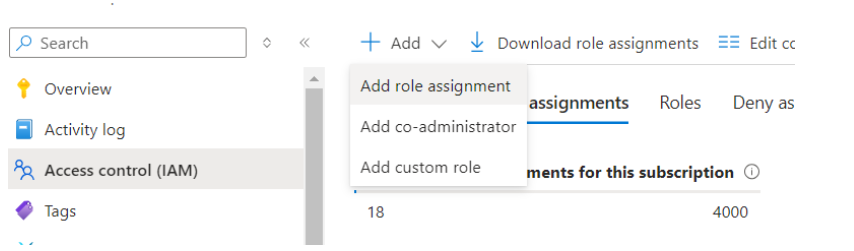

2. Find **Key Vault Administrator** → in the **Members** section click **Select members**, add your account, then click **Review + assign**

   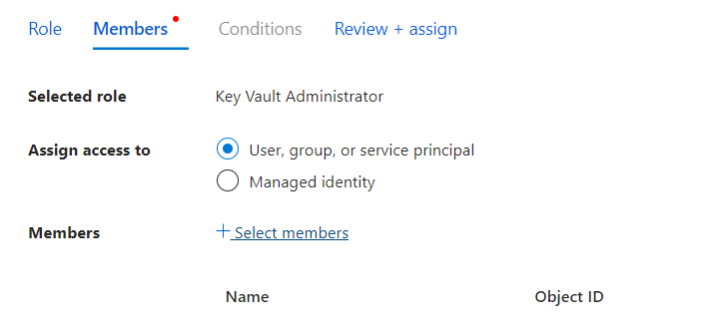

### For Databricks

You must be an **Account Admin** in the Databricks account console:

1. Go to [accounts.azuredatabricks.net/users](https://accounts.azuredatabricks.net/users)
2. Find your user, click **Roles**, and enable **Account Admin**

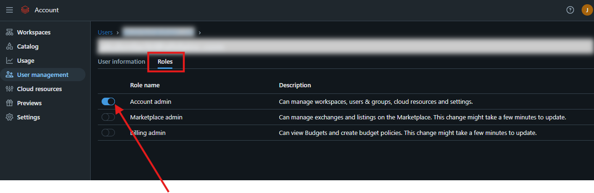

---

## 8. One-Time Platform Setup (Do This Once)

These steps are only done once per Azure subscription. Once complete, all future environment deployments are just clicks in the portal.

### 8.1 Install Required Software

Install the following on your local machine:

#### Git
```bash
# macOS (using Homebrew)
brew install git

# Ubuntu / Debian Linux
sudo apt-get install git

# Windows — download installer from:
# https://git-scm.com/download/win
```

Verify installation:
```bash
git --version
# Expected output: git version 2.x.x
```

#### Azure CLI

The Azure CLI lets you manage Azure from your terminal.

```bash
# macOS
brew install azure-cli

# Ubuntu / Debian Linux
curl -sL https://aka.ms/InstallAzureCLIDeb | sudo bash

# Windows — download the MSI installer from:
# https://aka.ms/installazurecliwindows
```

Verify installation:
```bash
az --version
# Expected output: azure-cli 2.x.x
```

#### Docker Desktop

Required to build the custom ADE runner container image.

Download and install from: [https://www.docker.com/products/docker-desktop](https://www.docker.com/products/docker-desktop)

After installation, verify:
```bash
docker --version
# Expected output: Docker version 24.x.x
```

### 8.2 Azure CLI Setup

Log in to your Azure account:

```bash
az login
```

A browser window will open. Sign in with your Azure account credentials.

After login, list your subscriptions to find the one you want to use:
```bash
az account list --output table
```

Set the subscription you want to use (copy the `SubscriptionId` from the table above):
```bash
az account set --subscription "YOUR_SUBSCRIPTION_ID"
```

Confirm it's set correctly:
```bash
az account show --output table
```

### 8.3 Terraform Installation

Terraform is the tool that reads the `.tf` files in this repository and creates the Azure resources.

```bash
# macOS (using Homebrew)
brew tap hashicorp/tap
brew install hashicorp/tap/terraform

# Ubuntu / Debian Linux
wget -O- https://apt.releases.hashicorp.com/gpg | sudo gpg --dearmor -o /usr/share/keyrings/hashicorp-archive-keyring.gpg
echo "deb [signed-by=/usr/share/keyrings/hashicorp-archive-keyring.gpg] https://apt.releases.hashicorp.com $(lsb_release -cs) main" | sudo tee /etc/apt/sources.list.d/hashicorp.list
sudo apt update && sudo apt install terraform

# Windows — download from:
# https://developer.hashicorp.com/terraform/downloads
```

Verify the installation (this project requires version 1.0 or higher):
```bash
terraform --version
# Expected output: Terraform v1.x.x
```

### 8.4 Service Principal Creation

A **Service Principal** is like a robot user account — it's how Terraform authenticates to Azure to create resources. We create one specifically for deployments.

**Step 1:** Get your subscription ID
```bash
SUBSCRIPTION_ID=$(az account show --query id -o tsv)
echo "Subscription ID: $SUBSCRIPTION_ID"
```

**Step 2:** Create the Service Principal with the required roles
```bash
az ad sp create-for-rbac \
  --name "sp-adenv-deployer" \
  --role "Contributor" \
  --scopes "/subscriptions/$SUBSCRIPTION_ID" \
  --output json
```

The output will look like:
```json
{
  "appId": "xxxxxxxx-xxxx-xxxx-xxxx-xxxxxxxxxxxx",
  "displayName": "sp-adenv-deployer",
  "password": "xxxxxxxxxxxxxxxxxxxxxxxxxxxxxxxxxxxxxxxx",
  "tenant": "xxxxxxxx-xxxx-xxxx-xxxx-xxxxxxxxxxxx"
}
```

> **⚠️ Important:** Save the `appId` (this is the `client_id`) and `password` (this is the `client_secret`) immediately. The password is only shown once and cannot be retrieved again.

**Step 3:** Grant additional required roles

```bash
# Replace with your actual values from the output above
SP_APP_ID="YOUR_APP_ID_FROM_ABOVE"

# User Access Administrator — allows the SP to assign RBAC roles
az role assignment create \
  --assignee "$SP_APP_ID" \
  --role "User Access Administrator" \
  --scope "/subscriptions/$SUBSCRIPTION_ID"
```

**Step 4:** Grant the SP permission to create App Registrations in Azure Active Directory

```bash
# Get the Service Principal's Object ID
SP_OBJECT_ID=$(az ad sp show --id "$SP_APP_ID" --query id -o tsv)

# Grant Application.ReadWrite.All permission (needed to create app registrations)
# This requires Azure AD Global Admin or Privileged Role Administrator
az ad app permission add \
  --id "$SP_APP_ID" \
  --api "00000003-0000-0000-c000-000000000000" \
  --api-permissions "1bfefb4e-e0b5-418b-a88f-73c46d2cc8e9=Role"

az ad app permission admin-consent --id "$SP_APP_ID"
```

> **Note:** If you don't have permission to grant admin consent, ask your Azure AD administrator to run the last command.

### 8.5 Platform Key Vault Setup (kv-adenv)

This Key Vault stores the Service Principal credentials. The ADE runner reads from it during every deployment.

**Step 1:** Create the platform resource group
```bash
az group create \
  --name "rg-adenv" \
  --location "westus2"
```

**Step 2:** Create the Key Vault

```bash
az keyvault create \
  --name "kv-adenv" \
  --resource-group "rg-adenv" \
  --location "westus2" \
  --enable-rbac-authorization true
```

**Step 3:** Grant yourself access to add secrets
```bash
MY_OBJECT_ID=$(az ad signed-in-user show --query id -o tsv)

az role assignment create \
  --assignee "$MY_OBJECT_ID" \
  --role "Key Vault Administrator" \
  --scope "/subscriptions/$SUBSCRIPTION_ID/resourceGroups/rg-adenv/providers/Microsoft.KeyVault/vaults/kv-adenv"
```

**Step 4:** Store the Service Principal credentials as secrets
```bash
# Replace these with your actual SP values from Section 8.4
SP_CLIENT_ID="YOUR_SP_APP_ID"
SP_CLIENT_SECRET="YOUR_SP_PASSWORD"

az keyvault secret set \
  --vault-name "kv-adenv" \
  --name "sp-client-id" \
  --value "$SP_CLIENT_ID"

az keyvault secret set \
  --vault-name "kv-adenv" \
  --name "sp-client-secret" \
  --value "$SP_CLIENT_SECRET"
```

### 8.6 Terraform State Storage Account

Terraform needs a place to store its "state file" — a record of what resources it has created. We use an Azure Storage Account for this.

```bash
# Create the resource group for Terraform state
az group create \
  --name "rg-adenv-tfstate" \
  --location "westus2"

# Create the storage account (name must be globally unique and only lowercase letters + numbers)
az storage account create \
  --name "saadenvtfstate" \
  --resource-group "rg-adenv-tfstate" \
  --location "westus2" \
  --sku Standard_LRS \
  --kind StorageV2

# Create the container inside the storage account
az storage container create \
  --name "tfstate" \
  --account-name "saadenvtfstate"
```

**Grant the Service Principal access to the state storage account:**
```bash
STORAGE_ACCOUNT_ID=$(az storage account show \
  --name "saadenvtfstate" \
  --resource-group "rg-adenv-tfstate" \
  --query id -o tsv)

az role assignment create \
  --assignee "$SP_APP_ID" \
  --role "Storage Blob Data Contributor" \
  --scope "$STORAGE_ACCOUNT_ID"
```

### 8.7 Register Azure Resource Providers

Azure requires you to "register" certain services before you can use them. Run these commands once:

```bash
az provider register --namespace Microsoft.HDInsight
az provider register --namespace Microsoft.Databricks
az provider register --namespace Microsoft.KeyVault
az provider register --namespace Microsoft.Storage
az provider register --namespace Microsoft.Sql
az provider register --namespace Microsoft.Web
az provider register --namespace Microsoft.ContainerRegistry
az provider register --namespace Microsoft.OperationalInsights
az provider register --namespace Microsoft.Network
az provider register --namespace Microsoft.ManagedIdentity
```

Check that they are all "Registered":
```bash
az provider show --namespace Microsoft.Databricks --query registrationState -o tsv
# Expected: Registered
```

---

## 9. Repository Setup

### 9.1 How to Clone the Repository

```bash
# Navigate to where you want the project on your computer
cd ~/projects

# Clone the repository (replace with your actual repo URL)
git clone https://YOUR_TOKEN@dev.azure.com/YOUR_ORG/YOUR_PROJECT/_git/ADE-Platform-Setup

# Enter the project folder
cd ADE-Platform-Setup
```

If you're using SSH authentication:
```bash
git clone git@ssh.dev.azure.com:v3/YOUR_ORG/YOUR_PROJECT/ADE-Platform-Setup
cd ADE-Platform-Setup
```

### 9.2 Folder Structure Explained

```
ADE-Platform-Setup/
│
├── README.md                          ← This file
│
├── catalog/
│   └── templates/
│       └── ad-environment/            ← The ADE catalog template
│           │
│           ├── environment.yaml       ← ADE template definition — defines the
│           │                            form fields shown in the developer portal
│           │
│           ├── main.tf                ← Entry point for Terraform — calls the
│           │                            adenv module and wires everything together
│           │
│           ├── variables.tf           ← Declares all variables that deploy.sh
│           │                            passes in at runtime
│           │
│           ├── outputs.tf             ← Values displayed in the ADE portal after
│           │                            deployment (URLs, IDs, etc.)
│           │
│           ├── modules/
│           │   ├── adenv/             ← The main Terraform module — contains all
│           │   │   │                    resource definitions
│           │   │   ├── databricks.tf       ← Databricks workspace + cluster + Unity Catalog
│           │   │   ├── keyvault.tf         ← Key Vault + private endpoint
│           │   │   ├── keyvault_secrets.tf ← All secrets written to Key Vault
│           │   │   ├── network.tf          ← VNet, subnets, NSGs
│           │   │   ├── storage_account.tf  ← ADLS Gen2 storage account
│           │   │   ├── sql.tf              ← SQL Server + Database
│           │   │   ├── container_registry.tf ← Azure Container Registry
│           │   │   ├── app_service.tf      ← App Service (API hosting)
│           │   │   ├── app_registration.tf ← Azure AD app registrations
│           │   │   ├── grants.tf           ← All RBAC role assignments
│           │   │   ├── log_analytics.tf    ← Log Analytics Workspace
│           │   │   ├── resource_group.tf   ← Resource group (reads existing)
│           │   │   ├── provider.tf         ← Terraform provider configuration
│           │   │   ├── variables.tf        ← All input variables for this module
│           │   │   ├── outputs.tf          ← Module outputs
│           │   │   ├── random.tf           ← Random suffix generator for unique names
│           │   │   └── README.md           ← Auto-generated resource documentation
│           │   │
│           │   └── shared/            ← Reusable child modules
│           │       ├── diagnostic_setting/ ← Module for setting up Log Analytics
│           │       │                         diagnostics on any resource
│           │       └── private_endpoint/   ← Module for creating private endpoints
│           │
│           ├── notebooks/
│           │   └── create_schema.py   ← Databricks notebook run automatically
│           │                            at end of deployment to create DB schema
│           │
│           └── sql/
│               └── create_tables_and_insert_values.sql  ← SQL script for initial
│                                                           schema and seed data
│
├── runner/
│   ├── Dockerfile                     ← Builds the custom ADE runner container
│   │                                    (based on Microsoft's ADE core image,
│   │                                    adds Terraform 1.7.5)
│   └── scripts/
│       └── deploy.sh                  ← The main deployment script — runs inside
│                                        the container, handles all stages:
│                                        login, fetch SP, run Terraform, post-deploy
│
└── img/                               ← Screenshots used in documentation
```

---

## 9.3 Terraform Module Reference

This section documents the inputs, outputs, and resources for each Terraform module in the repository. It is intended for developers who need to modify or extend the infrastructure code.

---

### Module: `adenv` (Main Environment Module)

> **Path:** `catalog/templates/ad-environment/modules/adenv/`
>
> This is the core module. It creates every resource that makes up a single client environment — networking, storage, database, Databricks, Key Vault, App Service, logging, and all RBAC assignments.

#### Requirements

| Name | Version |
|------|---------|
| terraform | >= 1.0 |
| azuread | ~> 2.0 |
| azurerm | ~> 3.0 |
| databricks | ~> 1.0 |

#### Providers

| Name | Version |
|------|---------|
| azuread | ~> 2.0 |
| azurerm | ~> 3.0 |
| databricks | ~> 1.0 |

#### Child Modules Used

| Name | Source |
|------|--------|
| `api_storage_account` | `../shared/storage_account` |
| `backup_storage_account` | `../shared/storage_account` |
| `config_storage_account` | `../shared/storage_account` |
| `localstore_storage_account` | `../shared/storage_account` |
| `databricks_diagnostic_setting` | `../shared/diagnostic_setting` |
| `datafactory_diagnostic_setting` | `../shared/diagnostic_setting` |
| `keyvault_diagnostic_setting` | `../shared/diagnostic_setting` |
| `keyvault_private_endpoint` | `../shared/private_endpoint` |
| `network_security_group_diagnostic_setting` | `../shared/diagnostic_setting` |
| `vnet_diagnostic_setting` | `../shared/diagnostic_setting` |

#### Inputs

| Name | Description | Type | Required |
|------|-------------|------|:--------:|
| `databricks` | Databricks cluster config, Spark config, library versions, repository URLs, service principal, and secret scope name | `object` | yes |
| `environment_name` | Name of the environment (e.g. `dev1`) | `string` | yes |
| `keyvault` | Key Vault access policy permissions and static secrets (notebook paths, API base path) | `object` | yes |
| `log_analytics` | Log Analytics retention period in days | `object` | yes |
| `network` | VNet address space and all subnet CIDR blocks (including Databricks subnets) | `object` | yes |
| `region` | Azure region for all resources (e.g. `westus2`) | `string` | yes |
| `sql` | PostgreSQL Flexible Server config — version, username, password, zone, storage size | `object` | yes |

#### Outputs

| Name | Description |
|------|-------------|
| `id` | Resource group ID |
| `name` | Resource group name |
| `location` | Resource group location |
| `keyvault_endpoint` | Key Vault endpoint URL |
| `blob_endpoint` | API storage account blob endpoint |
| `log_analytics_workspace_id` | Log Analytics workspace ID |
| `meshapi_subnet_id` | App Service subnet ID |
| `acr_subnet_id` | Container Registry subnet ID |
| `acr_dns_id` | Container Registry private DNS zone ID |
| `acr_dns_name` | Container Registry private DNS zone name |

---

### Module: `shared/diagnostic_setting`

> **Path:** `catalog/templates/ad-environment/modules/shared/diagnostic_setting/`
>
> A reusable module that attaches Azure Monitor diagnostic settings to any resource, forwarding all logs and metrics to the environment's Log Analytics workspace. Used by the `adenv` module for VNet, NSG, Key Vault, Databricks, and Data Factory.

#### Providers

| Name | Version |
|------|---------|
| azurerm | 3.63.0 |

#### Inputs

| Name | Description | Type | Required |
|------|-------------|------|:--------:|
| `log_analytics_workspace_id` | Log Analytics workspace ID to send diagnostics to | `string` | yes |
| `resource_id` | ID of the Azure resource to enable diagnostics on | `string` | yes |
| `resource_name` | Name of the Azure resource (used to name the diagnostic setting) | `string` | yes |

#### Outputs

None.

---

### Module: `shared/private_endpoint`

> **Path:** `catalog/templates/ad-environment/modules/shared/private_endpoint/`
>
> A reusable module that creates a private endpoint and its corresponding private DNS A-record for any Private Link-enabled Azure resource. Also wires up diagnostic settings via the `diagnostic_setting` child module.

#### Providers

| Name | Version |
|------|---------|
| azurerm | 3.63.0 |

#### Child Modules Used

| Name | Source |
|------|--------|
| `diagnostic_setting` | `../diagnostic_setting` |

#### Inputs

| Name | Description | Type | Required |
|------|-------------|------|:--------:|
| `name` | Name of the private endpoint resource | `string` | yes |
| `location` | Azure region for the private endpoint | `any` | yes |
| `resource_group_name` | Resource group to deploy the private endpoint into | `string` | yes |
| `subnet_id` | Subnet ID where the private endpoint NIC will be placed | `string` | yes |
| `private_link_enabled_resource_id` | Resource ID of the service to connect privately | `string` | yes |
| `subresource_names` | Subresource names for the private link connection (e.g. `["blob"]`, `["vault"]`) | `list(string)` | yes |
| `private_dns` | Map containing the private DNS zone `resource_id`, `name`, and `a_name` for DNS registration | `map(string)` | yes |
| `log_analytics_workspace_id` | Log Analytics workspace ID for diagnostic settings | `string` | yes |

#### Outputs

None.

---

## 10. Azure Deployment Environments (ADE) Setup

### 10.1 What is ADE?

Azure Deployment Environments (ADE) is a Microsoft service that lets developers create pre-configured cloud environments from a self-service web portal. Think of it like ordering from a menu — the developer picks "AD Environment", fills in a few fields, and the platform builds everything automatically.

The key components are:
- **Dev Center** — The top-level ADE resource in Azure
- **Catalog** — A connection to this Git repository, so ADE knows what templates are available
- **Project** — A grouping of environments (e.g., one project per client or team)
- **Environment Type** — A label like "Development", "Staging", "Production" mapped to different subscriptions

### 10.2 Create a Dev Center

1. Go to the [Azure Portal](https://portal.azure.com)
2. Search for **"Dev Centers"** in the top search bar
3. Click **Create**
4. Fill in:
   - **Subscription**: your subscription
   - **Resource Group**: create new → `rg-adenv-devcenter`
   - **Name**: `devcenter-adenv`
   - **Location**: `West US 2`
5. Click **Review + Create**, then **Create**
6. Wait for deployment to complete, then click **Go to resource**

### 10.3 Connect the Catalog

The catalog tells ADE where to find the environment templates (the `environment.yaml` and Terraform files).

1. In your Dev Center, click **Catalogs** in the left menu
2. Click **Add**
3. Fill in:
   - **Name**: `ade-platform-catalog`
   - **Catalog type**: Azure DevOps (or GitHub, depending on where your repo is)
   - **Repository**: your repository URL
   - **Branch**: `main`
   - **Folder path**: `catalog`
4. You'll need to grant the Dev Center's managed identity access to your repo
5. Click **Add**, then wait for the sync status to show **Succeeded**

### 10.4 Create a Project

Projects group environments and control who can create them.

1. In the Dev Center, click **Projects** → **Create**
2. Fill in:
   - **Name**: `adenv-platform` (or a client-specific name)
   - **Resource Group**: you can use `rg-adenv`
3. Go to the project → **Environment Types** → **Add**
4. Create environment types like `Development`, `Staging`, `Production`
5. For each environment type, select the Azure subscription where environments will be deployed

### 10.5 Assign the ADE Runner Managed Identity

The runner container that executes `deploy.sh` uses a **Managed Identity** — a secure way to authenticate without a username/password. You need to grant this identity the right permissions.

1. In the Dev Center → **Identity** → Enable **System-assigned managed identity**
2. Note the **Object (principal) ID** shown
3. Grant it the following roles on your subscription:

```bash
# Replace with your Dev Center's managed identity Object ID
DEVCENTER_MI_OBJECT_ID="YOUR_DEVCENTER_MI_OBJECT_ID"

# Contributor on the subscription
az role assignment create \
  --assignee "$DEVCENTER_MI_OBJECT_ID" \
  --role "Contributor" \
  --scope "/subscriptions/$SUBSCRIPTION_ID"

# Key Vault Secrets User on the platform Key Vault
az role assignment create \
  --assignee "$DEVCENTER_MI_OBJECT_ID" \
  --role "Key Vault Secrets User" \
  --scope "/subscriptions/$SUBSCRIPTION_ID/resourceGroups/rg-adenv/providers/Microsoft.KeyVault/vaults/kv-adenv"
```

> **Note:** `deploy.sh` also self-heals this role assignment automatically at startup, but granting it in advance avoids the RBAC propagation delay on first run.

---

## 11. Building the Custom ADE Runner

The ADE runner is a Docker container image that contains all tools needed for deployment: the Azure CLI, Terraform, and the `deploy.sh` script. You must build this image and push it to an Azure Container Registry.

**Step 1:** Create an ACR for the runner image (one-time setup)

```bash
az acr create \
  --resource-group "rg-adenv" \
  --name "adetfrunner" \
  --sku Basic \
  --admin-enabled true
```

**Step 2:** Log in to the ACR

```bash
az acr login --name "adetfrunner"
```

**Step 3:** Build and push the runner image

```bash
# Navigate to the runner folder in this repository
cd runner/

# Build the Docker image
docker build -t adetfrunner.azurecr.io/ade-terraform-runner:v3 .

# Push to ACR
docker push adetfrunner.azurecr.io/ade-terraform-runner:v3
```

The `environment.yaml` file references this image via:
```yaml
runner: "adetfrunner.azurecr.io/ade-terraform-runner:v3"
```

**Step 4:** Grant the Dev Center access to pull the runner image

```bash
ACR_ID=$(az acr show --name "adetfrunner" --resource-group "rg-adenv" --query id -o tsv)

az role assignment create \
  --assignee "$DEVCENTER_MI_OBJECT_ID" \
  --role "AcrPull" \
  --scope "$ACR_ID"
```

---

## 12. Deploying an Environment

### 12.1 Via the Azure Developer Portal (Recommended)

This is the normal, day-to-day way to create a new client environment.

1. Go to [https://devportal.microsoft.com](https://devportal.microsoft.com)
2. Sign in with your Azure account
3. Click **New environment**
4. Select the **Project** you created (e.g., `adenv-platform`)
5. Select an **Environment Type** (e.g., `Development`)
6. Select the template **`ad-environment`**
7. Fill in the parameters:

   | Parameter | Description | Example |
   |---|---|---|
   | **Environment Name** | Short label for this environment — this becomes `env_name` | `dev1` |
   | **Databricks Account ID** | Your Databricks account UUID from `accounts.azuredatabricks.net` | `b65357a6-...` |
   | **Unity Catalog Metastore ID** | Leave blank to create a new one, or provide existing ID | (leave blank) |
   | **VNet CIDR Blocks** | Two IP ranges separated by comma. Use defaults unless deploying multiple environments that would overlap | `10.0.0.0/16,10.100.0.0/16` |
   | **Databricks Admin Users** | Comma-separated emails to grant Databricks admin access | `alice@company.com,bob@company.com` |

8. Click **Create**

The deployment typically takes **25–45 minutes**. You can monitor progress in the portal.

After completion, the portal shows deployment outputs including:
- App Service URL
- Databricks Workspace URL
- Key Vault endpoint
- Storage Account endpoint
- SQL Server FQDN

### 12.2 Via Azure Cloud Shell

If you prefer to deploy directly using the Azure Cloud Shell instead of the developer portal, follow these steps:

1. **Open Azure Cloud Shell:**
   - Go to the [Azure Portal](https://portal.azure.com/) and open **Azure Cloud Shell**.

   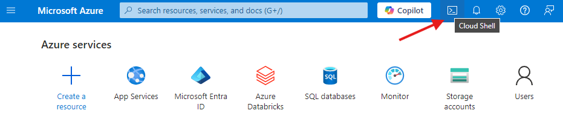

2. **Log in to Azure and select a subscription:**
   ```bash
   az login
   ```

3. **Register the required provider:**
   ```bash
   az provider register --namespace Microsoft.HDInsight
   ```

4. **Set up a working directory:**
   ```bash
   mkdir terraform && cd terraform
   ```

5. **Clone the repository and navigate to your environment folder:**
   ```bash
   git clone https://{your-token}@dev.azure.com/YOUR_ORG/YOUR_PROJECT/_git/ADE-Platform-Setup && cd ADE-Platform-Setup
   cd environments/your-env
   ```

6. **Get your current IP address** (needed for firewall rules during deployment):
   ```bash
   curl -s checkip.dyndns.org | sed -e 's/.*Current IP Address: //' -e 's/<.*$//'
   ```
   Save this value — you will be prompted for it.

7. **Initialize and apply Terraform:**
   ```bash
   terraform init
   terraform apply -parallelism=2
   ```

8. **Enter the required values when prompted:**

   | Prompt | Value |
   |---|---|
   | Metastore ID | From Databricks Account Console (see Section 14.1) |
   | Databricks Account ID | From your Databricks profile |
   | IP Address | From step 6 above |
   | Source ACR Name | Azure Container Registry name |
   | Source ACR Password | From ACR → Access Keys in the Azure Portal |

   > **To find your ACR Name and Password:** Go to **Container Registry** in the Azure Portal → select your registry → **Access Keys** → note the **Registry Name** and **Password**.
   >
   > 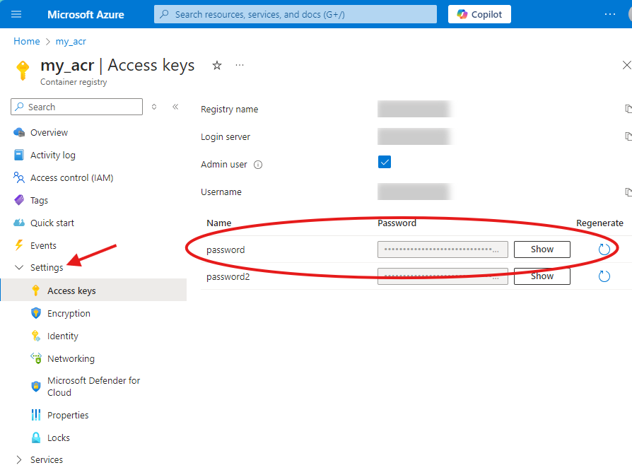

9. **Troubleshooting:** If any errors occur, run `terraform destroy` to remove all created resources and then re-run `terraform apply`.

### 12.3 What Happens During Deployment (Step by Step)

Here's what `deploy.sh` does automatically once you click Create:

1. **Derive names** — Calculates `client_name`, `env_name`, `prefix`, and `storage_account_name` from the ADE context. You never type these.

2. **Login via Managed Identity** — The runner container logs in to Azure using its own identity (no password needed).

3. **Self-heal RBAC** — Ensures the runner has `Key Vault Secrets User` access on `kv-adenv`. Waits up to 12 minutes for the permission to propagate.

4. **Fetch SP credentials** — Reads `sp-client-id` and `sp-client-secret` from `kv-adenv`.

5. **Set environment variables** — Sets `ARM_CLIENT_ID`, `ARM_CLIENT_SECRET`, etc. so Terraform can authenticate.

6. **Patch SQL password strength** — Automatically updates `sql.tf` to enforce a strong random password meeting Azure complexity requirements.

7. **Terraform init** — Downloads provider plugins (azurerm, azuread, databricks) and connects to the remote state backend.

8. **Check for stale locks** — If a previous deployment crashed mid-run and left a state lock, it automatically force-unlocks it (only if the lock is older than 15 minutes).

9. **Stage 1 apply** — Creates only the RBAC role assignments and Storage Account first, then waits 60 seconds for permissions to propagate.

10. **Stage 2 apply** — Creates all remaining resources (VNet, KV, SQL, Databricks, ACR, App Service, etc.). Retries once if it fails due to subnet provisioning delays.

11. **Remove runner IP from firewall** — Cleans up the temporary firewall rule that allowed Terraform to access the storage account.

12. **Wait for Databricks cluster** — Waits up to 30 minutes for the cluster to start.

13. **Run schema notebook** — Uploads `create_schema.py` to the Databricks workspace and runs it to create the initial database schema.

14. **Deployment complete.**

---

## 13. Manual Terraform Deployment (Advanced / Local)

> **⚠️ Warning:** Manual deployment bypasses the ADE runner logic in `deploy.sh`. Only do this if you are troubleshooting or developing the templates locally. For production deployments, always use the ADE portal.

If you need to run Terraform manually (e.g., for debugging), follow these steps:

**Step 1:** Set authentication environment variables

```bash
export ARM_CLIENT_ID="YOUR_SP_CLIENT_ID"
export ARM_CLIENT_SECRET="YOUR_SP_CLIENT_SECRET"
export ARM_TENANT_ID="YOUR_TENANT_ID"
export ARM_SUBSCRIPTION_ID="YOUR_SUBSCRIPTION_ID"

export DATABRICKS_AZURE_CLIENT_ID="$ARM_CLIENT_ID"
export DATABRICKS_AZURE_CLIENT_SECRET="$ARM_CLIENT_SECRET"
export DATABRICKS_AZURE_TENANT_ID="$ARM_TENANT_ID"
```

**Step 2:** Navigate to the template directory

```bash
cd catalog/templates/ad-environment
```

**Step 3:** Initialize Terraform

```bash
terraform init \
  -backend-config="resource_group_name=rg-adenv-tfstate" \
  -backend-config="storage_account_name=saadenvtfstate" \
  -backend-config="container_name=tfstate" \
  -backend-config="key=apple-dev1.tfstate" \
  -backend-config="use_azuread_auth=true"
```

**Step 4:** Plan (preview what will be created — no changes made)

```bash
terraform plan \
  -var "client_name=apple" \
  -var "env_name=dev1" \
  -var "prefix=apple-dev1" \
  -var "storage_account_name=saappledev1" \
  -var "resource_group_name=rg-apple-dev1" \
  -var "tenant_id=$ARM_TENANT_ID" \
  -var "subscription_id=$ARM_SUBSCRIPTION_ID" \
  -var "sp_client_id=$ARM_CLIENT_ID" \
  -var "sp_client_secret=$ARM_CLIENT_SECRET" \
  -var "databricks_account_id=YOUR_DATABRICKS_ACCOUNT_ID" \
  -var "unity_catalog_metastore_id=" \
  -var "vnet_cidr=10.0.0.0/16,10.100.0.0/16" \
  -var "predefined_application_id=2ff814a6-3304-4ab8-85cb-cd0e6f879c1d" \
  -var "secret_scope_name=kv-apple-dev1-placeholder" \
  -var "runner_object_id=" \
  -var 'databricks_admin_users=[]'
```

**Step 5:** Apply (actually create the resources)

```bash
terraform apply -parallelism=2 [same -var flags as above]
```

> **Note:** Use `-parallelism=2` to avoid Azure rate limiting when creating many resources simultaneously.

**Step 6:** To destroy all resources

```bash
terraform destroy [same -var flags as above]
```

---

## 14. Databricks Setup

### 14.1 Unity Catalog Metastore

Unity Catalog is Databricks' data governance layer. An environment can either:
- **Create a new metastore** — Leave `unity_catalog_metastore_id` blank in the portal form
- **Attach to an existing metastore** — Provide the metastore ID

To find an existing metastore ID:

1. Go to [accounts.azuredatabricks.net/data](https://accounts.azuredatabricks.net/data)
2. Click on your metastore
3. The **Metastore ID** is the UUID at the end of the URL

   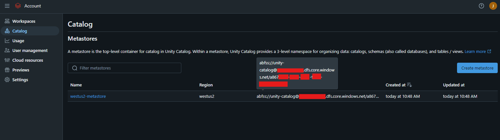

To find your **Databricks Account ID**:

1. Log in to [accounts.azuredatabricks.net](https://accounts.azuredatabricks.net)
2. Click your profile/email in the top right
3. The **Account ID** is shown there

   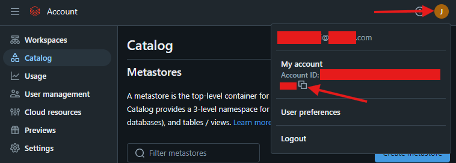

> **⚠️ Note:** If no metastores exist in your region, follow [Microsoft's guide to create one](https://learn.microsoft.com/en-us/azure/databricks/data-governance/unity-catalog/create-metastore) before deploying.

### 14.2 Assign Service Principal as Metastore Admin

To allow Terraform or automation processes to manage Unity Catalog resources, assign the required Service Principal as the **Metastore Admin**.

1. Open the **Databricks Account Console**
2. Navigate to **Catalog**
3. Select your metastore
4. Under **Metastore Admin**, click **Edit**
5. Search for and select the required **Service Principal**
6. Click **Save**

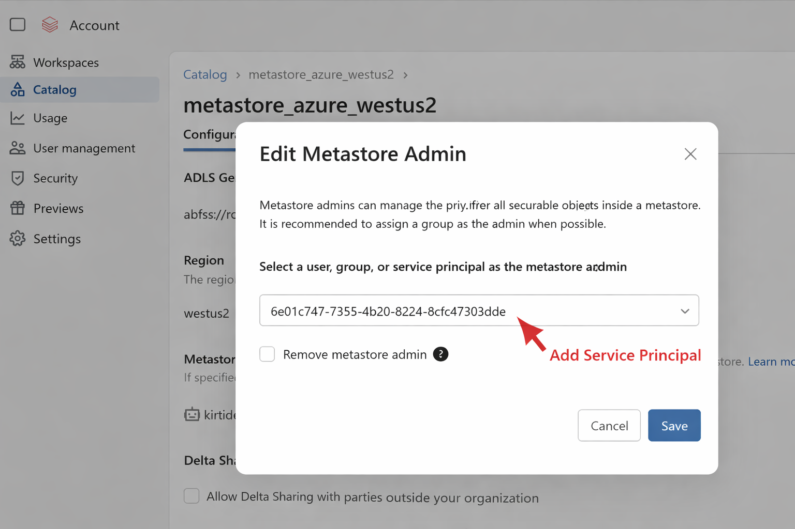

### 14.3 Assign Workspace to Metastore

To connect a Databricks workspace with the Unity Catalog metastore:

1. Open the **Databricks Account Console**
2. Navigate to **Catalog**
3. Select your metastore
4. Open the **Workspaces** tab
5. Click **Assign to workspace**
6. Select the required workspace
7. Click **Confirm**

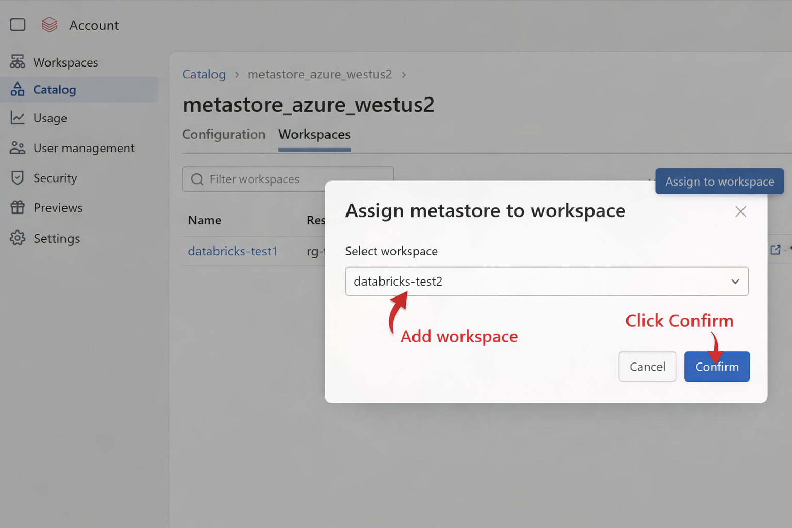

### 14.4 Grant Databricks Account Admin Rights

You (or whoever is deploying) must have **Account Admin** rights in Databricks:

1. Have an existing Databricks admin go to [accounts.azuredatabricks.net/users](https://accounts.azuredatabricks.net/users)
2. Find your user account
3. Click **Roles** and assign **Account Admin**


---

## 15. Azure App Registration API Permissions

To run the Terraform deployment successfully, the Azure App Registration must have the required Microsoft Graph API permissions.

1. Navigate to **Azure Portal → App Registrations → your-app-registration → API Permissions**
2. Click **Add a permission**
3. Select **Microsoft Graph**
4. Choose **Application permissions** and add the following permissions:
   - `Application.Read.All`
   - `Application.ReadWrite.All`
   - `Application.ReadWrite.OwnedBy`
   - `AccessReview.Read.All`
   - `AccessReview.ReadWrite.All`
5. After adding the permissions, click **Grant admin consent** and confirm
6. Verify the status shows **Granted** for all entries

   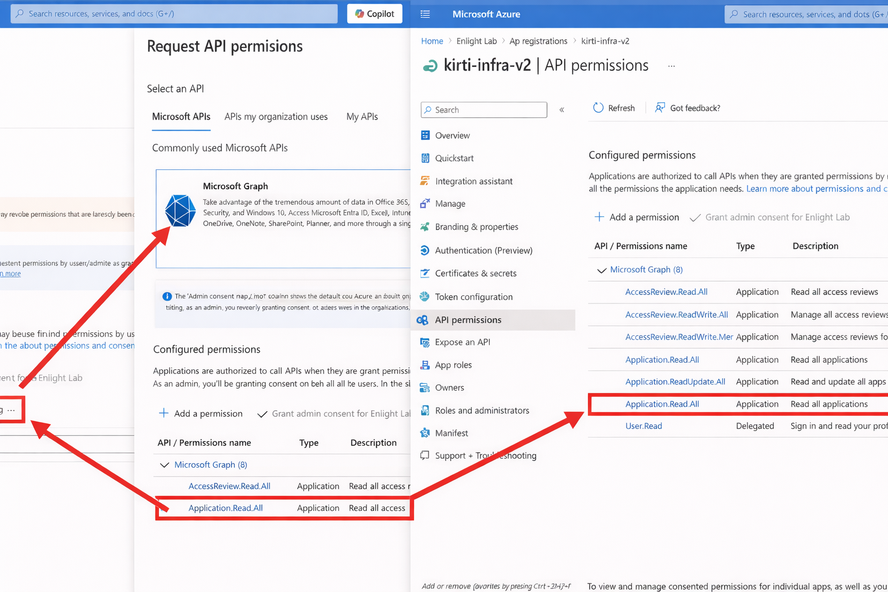

   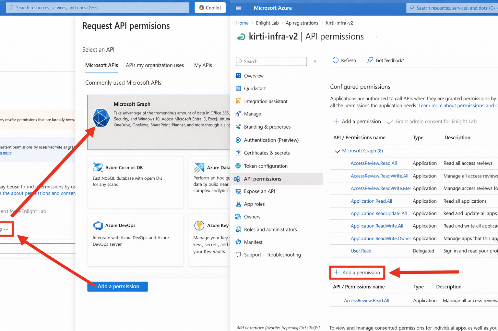

> **⚠️ Important:** Without these permissions, Terraform may fail while creating or managing Azure identity-related resources.

---

## 16. Add a New Environment to the Repository

> This step is only needed if you are creating a completely new named environment that does not yet exist in the repository.

1. Clone this repository to your local machine (or open it in Databricks Repos)
2. In the `environments/` folder, duplicate an existing environment folder and rename it to match your new environment name
3. Open `main.tf` in the new folder and update the `locals` block at the top:

```hcl
locals {
  environment_name = "my_new_env"
  region           = "westus2"
}
```

4. Push this change to the `main` branch (via Pull Request if required by your team's workflow)

Once merged, the new environment will be available as a deployment target.

---

## 17. VS Code Extensions

If you're editing the Terraform code locally, install these VS Code extensions for the best experience:

| Extension | Publisher | Purpose |
|---|---|---|
| `HashiCorp Terraform` | HashiCorp | Syntax highlighting, auto-completion, and validation for `.tf` files |
| `Azure Terraform` | Microsoft | Azure-specific Terraform helpers |
| `Azure Account` | Microsoft | Azure authentication in VS Code |
| `Azure Resources` | Microsoft | Browse Azure resources from VS Code |
| `GitLens` | GitKraken | Enhanced Git history and blame |
| `YAML` | Red Hat | Syntax highlighting for `environment.yaml` |
| `Docker` | Microsoft | Dockerfile editing and container management |
| `ShellCheck` | Timon Wong | Linting for `deploy.sh` and other shell scripts |

Install via the VS Code Extensions panel (`Ctrl+Shift+X`) or via the CLI:

```bash
code --install-extension hashicorp.terraform
code --install-extension ms-azuretools.vscode-azureterraform
code --install-extension ms-vscode.azure-account
code --install-extension ms-azuretools.vscode-azureresourcegroups
code --install-extension eamodio.gitlens
code --install-extension redhat.vscode-yaml
code --install-extension ms-azuretools.vscode-docker
code --install-extension timonwong.shellcheck
```

---

## 18. Environment Variables Reference

### Variables injected by ADE automatically (you never set these)

| Variable | Description | Example |
|---|---|---|
| `ADE_RESOURCE_GROUP_NAME` | Name of the resource group ADE pre-creates | `rg-apple-dev1` |
| `ADE_ENVIRONMENT_NAME` | The environment name from the portal form | `dev1` |
| `ADE_TENANT_ID` | Your Azure AD tenant ID | `xxxxxxxx-xxxx-...` |
| `ADE_SUBSCRIPTION_ID` | The target Azure subscription | `xxxxxxxx-xxxx-...` |
| `ADE_OPERATION_PARAMETERS` | JSON blob of all portal form values | `{"databricks_account_id": "..."}` |
| `ADE_TEMPLATE_PATH` | Path to the catalog template inside the container | `/ade/repository/catalog/templates/ad-environment` |

### Variables derived by deploy.sh

| Variable | How It's Derived | Example |
|---|---|---|
| `CLIENT_NAME` | Strips `env_name` from `ADE_RESOURCE_GROUP_NAME` | `apple` |
| `ENV_NAME` | Same as `ADE_ENVIRONMENT_NAME` | `dev1` |
| `PREFIX` | `{CLIENT_NAME}-{ENV_NAME}` | `apple-dev1` |
| `SA_NAME` | `sa{client}{env}` truncated to 24 chars | `saappledev1` |

### Variables set for Terraform authentication

| Variable | Source |
|---|---|
| `ARM_CLIENT_ID` | Read from `kv-adenv` secret `sp-client-id` |
| `ARM_CLIENT_SECRET` | Read from `kv-adenv` secret `sp-client-secret` |
| `ARM_TENANT_ID` | From `ADE_TENANT_ID` |
| `ARM_SUBSCRIPTION_ID` | From `ADE_SUBSCRIPTION_ID` |
| `DATABRICKS_AZURE_CLIENT_ID` | Same as `ARM_CLIENT_ID` |
| `DATABRICKS_AZURE_CLIENT_SECRET` | Same as `ARM_CLIENT_SECRET` |
| `DATABRICKS_AZURE_TENANT_ID` | Same as `ARM_TENANT_ID` |

---

## 19. Networking Overview

Every environment gets a **dedicated Virtual Network** with **two address spaces** and **eight subnets**. All inter-service communication flows through private endpoints — no traffic goes over the public internet.

### Default IP Ranges

| Network | Default CIDR | Use |
|---|---|---|
| General VNet | `10.0.0.0/16` | All non-Databricks resources |
| Databricks VNet | `10.100.0.0/16` | Databricks compute only |

### Subnets (General VNet — derived automatically from the general CIDR)

| Subnet | CIDR (default) | Resources |
|---|---|---|
| Storage Account Subnet | `10.0.2.0/24` | Storage Account private endpoint |
| SQL Subnet | `10.0.3.0/24` | SQL Server private endpoint |
| Key Vault Subnet | `10.0.4.0/24` | Key Vault private endpoint |
| App Service Subnet | `10.0.5.0/24` | App Service VNet integration |
| ACR Subnet | `10.0.6.0/24` | Container Registry private endpoint |

### Subnets (Databricks VNet — derived from the Databricks CIDR)

| Subnet | CIDR (default) | Resources |
|---|---|---|
| Databricks Public Subnet | `10.100.1.0/24` | Databricks driver and worker nodes (outbound) |
| Databricks Private Subnet | `10.100.2.0/24` | Databricks worker nodes (inbound) |

> **Deploying multiple environments?** Each environment must use non-overlapping CIDR ranges. For a second environment, use:
> - VNet CIDR: `10.1.0.0/16,10.101.0.0/16`
> For a third: `10.2.0.0/16,10.102.0.0/16`, and so on.

---

## 20. Key Vault Secrets Reference

After deployment, the environment's Key Vault (`kv-{client}-{env}-{suffix}`) contains these secrets, all automatically populated by Terraform:

| Secret Name | Contents |
|---|---|
| `databricks-domain` | Full HTTPS URL of the Databricks workspace |
| `databricks-token` | Personal access token for Databricks API |
| `databricks-cluster-id` | ID of the auto-created cluster |
| `databricks-client-id` | App registration client ID for Databricks SP |
| `databricks-client-secret` | App registration secret for Databricks SP |
| `databricks-tenant-id` | Azure AD tenant ID |
| `databricks-name` | Databricks workspace name |
| `metastore-host` | SQL Server FQDN |
| `metastore-port` | SQL Server port (1433) |
| `metastore-username` | SQL admin username |
| `metastore-password` | SQL admin password (auto-generated, 20 chars) |
| `metastore-driver` | JDBC driver class name |

The **platform Key Vault** (`kv-adenv`) contains:

| Secret Name | Contents |
|---|---|
| `sp-client-id` | Service Principal app ID for deployments |
| `sp-client-secret` | Service Principal password for deployments |

---

## 21. Post-Deployment Validation

After the environment deploys successfully, verify everything is working:

**Step 1:** Check the ADE portal outputs — you should see URLs for the App Service, Databricks workspace, and Key Vault endpoint.

**Step 2:** Verify the resource group was created in the Azure Portal:
```bash
az group show --name "rg-{client}-{env}" --output table
```

**Step 3:** Verify Key Vault secrets were written:
```bash
az keyvault secret list \
  --vault-name "kv-{client}-{env}-{suffix}" \
  --query "[].name" \
  --output table
```

You should see all 13 secrets listed.

**Step 4:** Verify Databricks workspace is accessible:
```bash
# Get the workspace URL from Key Vault
DATABRICKS_HOST=$(az keyvault secret show \
  --vault-name "kv-{client}-{env}-{suffix}" \
  --name "databricks-domain" \
  --query value -o tsv)

echo "Databricks URL: $DATABRICKS_HOST"
```
Open the URL in your browser — you should see the Databricks login page.

**Step 5:** Verify the Databricks cluster is running:

1. Open the Databricks workspace
2. Go to **Compute**
3. The cluster `cluster-{client}-{env}` should be in **Running** or **Terminated** (auto-terminates after 20 minutes of inactivity — it restarts automatically when you run a notebook)

**Step 6:** Verify the App Service is responding:
```bash
APP_URL=$(az webapp show \
  --resource-group "rg-{client}-{env}" \
  --name "app-{client}-{env}" \
  --query defaultHostName -o tsv)

curl -I "https://$APP_URL/health"
# Expected: HTTP/1.1 200 OK
```

---

## 22. After Restarting Your Machine / Reconnecting Services

If you restart your computer or your Azure CLI session expires, you need to re-authenticate. **No infrastructure is affected** — your deployed environments remain running.

### Re-authenticate Azure CLI

```bash
az login
az account set --subscription "YOUR_SUBSCRIPTION_ID"
```

### Re-authenticate Docker to ACR (if building images)

```bash
az acr login --name "adetfrunner"
```

### Re-initialize Terraform (if running locally)

If you open a new terminal session and want to run Terraform commands:

```bash
# Re-export credentials
export ARM_CLIENT_ID="YOUR_SP_CLIENT_ID"
export ARM_CLIENT_SECRET="YOUR_SP_CLIENT_SECRET"
export ARM_TENANT_ID="YOUR_TENANT_ID"
export ARM_SUBSCRIPTION_ID="YOUR_SUBSCRIPTION_ID"

# Re-initialize (connects to remote state)
cd catalog/templates/ad-environment
terraform init \
  -backend-config="resource_group_name=rg-adenv-tfstate" \
  -backend-config="storage_account_name=saadenvtfstate" \
  -backend-config="container_name=tfstate" \
  -backend-config="key={client}-{env}.tfstate" \
  -backend-config="use_azuread_auth=true"
```

### Reconnect to Databricks

Databricks uses token-based authentication stored in the Key Vault. The token is created automatically during deployment. It does not expire unless you explicitly revoke it. No reconnection needed.

### What Restarts Automatically

These services **auto-restart** without any action from you:

- **App Service** — Always running, restarts automatically on Azure
- **Databricks Cluster** — Auto-starts when a notebook is run (after auto-termination)

These services **are always-on** and don't need restarting:

- Key Vault, Storage Account, SQL Server, VNet — always available

---

## 23. Cleanup and Destroy Instructions

> **⚠️ Warning:** Destroying an environment permanently deletes ALL resources — databases, storage, clusters, secrets. This cannot be undone. Make sure you have backups of any important data.

### Destroy via ADE Portal (Recommended)

1. Go to [https://devportal.microsoft.com](https://devportal.microsoft.com)
2. Find the environment you want to delete
3. Click the **...** menu → **Delete**
4. Confirm deletion

ADE will automatically run `terraform destroy` and delete all resources.

### Destroy via Terraform CLI (Manual)

```bash
# Set credentials
export ARM_CLIENT_ID="YOUR_SP_CLIENT_ID"
export ARM_CLIENT_SECRET="YOUR_SP_CLIENT_SECRET"
export ARM_TENANT_ID="YOUR_TENANT_ID"
export ARM_SUBSCRIPTION_ID="YOUR_SUBSCRIPTION_ID"

cd catalog/templates/ad-environment

# Re-init against the correct state file
terraform init \
  -backend-config="resource_group_name=rg-adenv-tfstate" \
  -backend-config="storage_account_name=saadenvtfstate" \
  -backend-config="container_name=tfstate" \
  -backend-config="key=apple-dev1.tfstate" \
  -backend-config="use_azuread_auth=true"

# Destroy all resources (you'll be prompted to type "yes" to confirm)
terraform destroy \
  -var "client_name=apple" \
  -var "env_name=dev1" \
  [... all other -var flags ...]
```

### Clean Up the Terraform State File

After destroying, delete the state file from the storage account:

```bash
az storage blob delete \
  --account-name "saadenvtfstate" \
  --container-name "tfstate" \
  --name "apple-dev1.tfstate" \
  --auth-mode login
```

---

## 24. Troubleshooting

### Error: "state blob is already locked"

**What it means:** A previous deployment crashed and left the Terraform state file locked.

**Fix:** `deploy.sh` handles this automatically — it force-unlocks locks older than 15 minutes. If you're running manually:

```bash
# First, run terraform plan to see the lock ID
terraform plan 2>&1 | grep "ID:"
# Note the lock ID (format: xxxxxxxx-xxxx-xxxx-xxxx-xxxxxxxxxxxx)

# Then force-unlock
terraform force-unlock -force "LOCK_ID_HERE"
```

---

### Error: "Platform KV RBAC failed" after 12 minutes

**What it means:** The ADE runner's managed identity could not get access to `kv-adenv` to fetch the SP credentials.

**Fix:**
1. Verify `kv-adenv` exists in `rg-adenv`:
   ```bash
   az keyvault show --name "kv-adenv" --resource-group "rg-adenv"
   ```
2. Verify the secrets `sp-client-id` and `sp-client-secret` exist:
   ```bash
   az keyvault secret list --vault-name "kv-adenv" --query "[].name" -o tsv
   ```
3. Manually grant the runner identity access (get the object ID from the deployment logs):
   ```bash
   az role assignment create \
     --assignee-object-id "RUNNER_OID_FROM_LOGS" \
     --assignee-principal-type ServicePrincipal \
     --role "Key Vault Secrets User" \
     --scope "/subscriptions/$SUBSCRIPTION_ID/resourceGroups/rg-adenv/providers/Microsoft.KeyVault/vaults/kv-adenv"
   ```

---

### Error: "Cluster did not become RUNNING within 30 minutes"

**What it means:** The Databricks cluster failed to start during post-deployment configuration.

**Fix:**
1. Open the Databricks workspace URL from the deployment outputs
2. Go to **Compute** → find the cluster
3. Click **Start** manually
4. Check the cluster's **Event Log** for error messages (often it's a missing library or network issue)

---

### Error: "SQL password does not meet complexity requirements"

**What it means:** Azure SQL requires passwords with uppercase, lowercase, numbers, and special characters.

**Fix:** `deploy.sh` automatically patches `sql.tf` to use a stronger password. If running manually, edit `modules/adenv/sql.tf` and change the `random_password` block to:

```hcl
resource "random_password" "password" {
  length           = 20
  min_lower        = 2
  min_upper        = 2
  min_numeric      = 2
  min_special      = 2
  override_special = "!#$%&?@"
  special          = true
}
```

---

### Error: "Subnets did not become ready" / VNet subnet provisioning errors

**What it means:** Azure sometimes takes longer than expected to provision VNet subnets, causing dependent resources (like Databricks) to fail.

**Fix:** `deploy.sh` retries automatically and waits up to 10 minutes for subnets. If running manually, simply re-run `terraform apply`. Terraform is idempotent — it won't recreate things that already exist.

```bash
terraform apply [same -var flags] -parallelism=2
```

---

### Error: "Orphaned private endpoint" conflicts

**What it means:** A previous failed deployment created some resources that weren't cleaned up, and now Terraform sees a conflict.

**Fix:** `deploy.sh` automatically cleans orphaned private endpoints and diagnostic settings before each apply. If running manually:

```bash
# Find the orphaned private endpoint
az network private-endpoint list \
  --resource-group "rg-{client}-{env}" \
  --query "[].name" -o tsv

# Delete it
az network private-endpoint delete \
  --resource-group "rg-{client}-{env}" \
  --name "NAME_OF_ORPHANED_PE"
```

Then re-run `terraform apply`.

---

### Error: "Application.ReadWrite.All" permission denied

**What it means:** The Service Principal doesn't have permission to create Azure AD App Registrations.

**Fix:** An Azure AD Global Administrator must run:
```bash
az ad app permission admin-consent --id "YOUR_SP_APP_ID"
```

---

### Error: Terraform providers not found after `terraform init`

**What it means:** Provider downloads failed, often due to network issues.

**Fix:**
```bash
# Clear the cached providers and re-init
rm -rf .terraform/
terraform init [backend-config flags]
```

---

### Deployment log location

All deployment output is logged inside the runner container at `/tmp/ade_deploy.log`. In ADE, deployment logs are accessible from the portal while the deployment is running or after it completes.

---

## 25. Best Practices

### Security

- **Never commit secrets to Git.** The `.gitignore` file already excludes `.tfvars` and `.env` files. Always use Key Vault to store credentials.
- **Rotate the Service Principal secret** every 90 days. Update `kv-adenv` with the new value immediately after rotation.
- **Use non-overlapping CIDR blocks** for each environment to avoid network conflicts if you ever need to peer VNets.
- **Key Vault purge protection is disabled** in this configuration (`purge_protection_enabled = false`). Consider enabling it in production to prevent accidental secret deletion.

### Terraform

- **Always run `terraform plan` before `terraform apply`** when making manual changes. Review the plan output carefully before typing `yes`.
- **Don't edit Terraform state manually.** Use `terraform state rm` or `terraform import` instead of editing the `.tfstate` file directly.
- **Use `-parallelism=2`** when running `terraform apply` manually. This reduces the chance of Azure rate-limiting errors on subscriptions with many concurrent operations.
- **Never run `terraform apply` against an environment that another deployment is actively modifying.** Check the ADE portal first.

### Environments

- **One environment = one resource group.** Never manually add resources to an ADE-managed resource group. Terraform will either overwrite or conflict with manual changes.
- **Use separate environments for dev, staging, and production** rather than reusing one environment for multiple stages.
- **For a second environment in the same subscription**, always use different VNet CIDRs to avoid IP conflicts.

### Databricks

- **Always use the Databricks Secret Scope** (backed by Key Vault) to access credentials from notebooks. Never hardcode passwords or tokens in notebooks.
- **Pin the cluster** — The cluster is created with `is_pinned = true`, which prevents it from being auto-deleted by Databricks when unused. Do not unpin it.
- **Auto-termination is set to 20 minutes** by default. This saves cost but means the cluster will restart (taking ~5 minutes) when you need it after inactivity.

---

## 26. Development

To modify the Terraform code, install pre-commit hooks by running this command from the repository root:

```bash
make build
```

This runs linting and validation checks automatically on every commit, catching issues early before they reach the repository.

During development, refer to [Google's Terraform best practices guide](https://cloud.google.com/docs/terraform/best-practices-for-terraform) for useful tips on code structure, module design, and maintainability. Treat it as a reference rather than a strict rulebook — adapt what makes sense for this project.

---

## Appendix: Quick Reference

### Key URLs

| Service | URL |
|---|---|
| Azure Portal | https://portal.azure.com |
| Azure Developer Portal | https://devportal.microsoft.com |
| Databricks Account Console | https://accounts.azuredatabricks.net |
| Terraform Registry | https://registry.terraform.io |
| Azure CLI Docs | https://learn.microsoft.com/en-us/cli/azure |

### Key Resource Names (Platform Infrastructure)

| Resource | Name |
|---|---|
| Platform Resource Group | `rg-adenv` |
| Platform Key Vault | `kv-adenv` |
| Terraform State Resource Group | `rg-adenv-tfstate` |
| Terraform State Storage Account | `saadenvtfstate` |
| Terraform State Container | `tfstate` |
| ADE Runner Registry | `adetfrunner.azurecr.io` |
| ADE Runner Image | `adetfrunner.azurecr.io/ade-terraform-runner:v3` |

### Terraform State Key Format

Each environment has its own state file in the blob container:
```
{client_name}-{env_name}.tfstate
```
Example: `apple-dev1.tfstate`

### Deployment Region

All resources are deployed to **West US 2** (`westus2`). This is hardcoded in `main.tf` and cannot be changed via the portal form.

---

*This README was generated from the `ADE-Platform-Setup` project. For questions or contributions, open a pull request against the `main` branch.*

---

<a id="current-hardened-deployment-guide"></a>

# New security-hardening guide

The original ZIP guide above is preserved in full, including its images. It describes
the original project's layout and procedures. Use this section for the current
`production-ad-env` package; its configuration and commands supersede conflicting
original instructions.

# AD environment — client-configurable security baseline

This package prepares the Azure/Databricks deployment code without needing a paid
Azure account during development. It is derived from the supplied archive, not
wired into the running POC, and must not be applied to the POC's existing state.

**Code validation is not production acceptance, HIPAA compliance certification,
or HITRUST certification.** The supplied API container's source is not in the ZIP;
its application behavior cannot be security-reviewed from an image reference.

## Package

| Location | Purpose |
| --- | --- |
| `terraform/` | Azure infrastructure, managed identities, private endpoints, subnet NSGs, Premium Firewall, DNS Resolver, SQL and app hosting |
| `databricks/` | Separate workspace configuration, compute ACLs, isolated UC credentials/locations/catalogs and workspace bindings |
| `Invoke-Deployment.ps1` | Explicit plan/apply workflow; requires approved saved-plan hash before apply |
| `check_plan.py` | Fail-closed selected engineering guardrails for both deployment phases |
| `validate.ps1` | Local formatting/schema checks, mocked Terraform plans, script parsing and Python regression tests; no Azure deployment |
| `migrations/create_schema.py` | Managed-identity SQL schema migration with TLS verification, bound values, version tracking and rollback |
| `*.example` | Client configuration templates; placeholders deliberately cannot deploy |

An opt-in `azure-pipelines.production-validation.yml` is in the repository root.
It runs validation only. The selected agent needs approved Terraform 1.14.x,
Python 3.12 and PowerShell 7; registry access is needed for provider initialization.
Existing POC pipelines are unchanged.

## Implemented safeguards

- Infrastructure and Databricks have separate state boundaries. A new workspace is
  not used to configure a provider while that workspace is still being created.
- Deployment uses a private runner's user-assigned managed identity. No provider
  client-secret inputs, generated Entra passwords, SQL passwords or Databricks PATs.
- App authentication references a client-owned, versionless Key Vault secret URI;
  its value is not copied into Terraform. App identity receives scoped AcrPull,
  storage-data and secret-reader roles, not resource-group-wide Owner.
- Application image must use a SHA256 digest from an existing private registry.
  Basic publishing authentication, FTP and the credential-bearing ACR webhook are disabled.
- Private endpoints cover workload services and the client-owned image registry
  and authentication vault. App Service is private and HTTPS-only.
- SQL uses Entra-only authentication, TDE, audit logging and 35-day short-term recovery.
  Data services have recovery protections; a resource-group CanNotDelete lock adds
  cloud-side protection. Decommission is a separate approved procedure.
- Databricks enables the HIPAA security profile, enhanced monitoring and automatic
  cluster updates. Phase 2 stores notebook results in the customer account, disables
  UI result downloads/clipboard, assigns restricted compute ACLs and binds isolated
  catalogs, locations and storage credentials to the environment workspace.
  UI restrictions do not replace data authorization or prevent every export path.
- Subnet-specific NSGs deny other inbound/outbound traffic. Required Databricks
  Private Link ports are scoped to the workspace private endpoint; other service
  paths are limited to HTTPS, private SQL, Azure DNS and identity metadata.
- All workload subnets route internet traffic through Premium Firewall with deny
  threat intelligence/IDPS. HTTPS destination rules use explicit approved FQDNs.
  No inbound internet/DNAT rule is created. TLS inspection is not configured.
- DNS Resolver supplies an inbound IP for corporate/VPN forwarding. No hosts-file
  workaround is required in the intended client DNS design.
- No automatic Terraform unlocking, orphan-resource deletion, public firewall
  exceptions, broad self-grants, suppressed deployment errors or targeted applies.

## Local validation now

From this directory:

```powershell
.\validate.ps1
```

Both roots use locked provider versions. The checks do not create resources or use
a cloud service connection. Eight Terraform tests use mocked providers and plan-only
runs; thirteen Python tests use synthetic plans/fake SQL connections.
A passing run does not prove runtime entitlement, network reachability, backups,
application security or vulnerability-free dependencies.

## Client onboarding before execution

Prepare these organization-owned dependencies; do not substitute personal POC values:

1. Approved subscription/region and an existing environment RG; non-overlapping
   private /16 address ranges allocated by IPAM.
2. A private deployment runner with a user-assigned managed identity. Give it only
   required deployment/role-assignment/lock permissions at approved scopes. Configure
   Databricks identity/workspace administration separately; do not create a PAT.
3. Encrypted, private, versioned remote state with restricted access and recovery.
   Use separate `client/environment/infrastructure.tfstate` and
   `client/environment/databricks.tfstate` keys.
4. A supported Databricks compliance-profile entitlement, regional metastore,
   supported runtime/SKU, and pre-provisioned restricted owner/user groups assigned
   to the workspace. Individual environments do not create/destroy the shared metastore.
5. A built/scanned application image in an existing Premium private ACR. The registry
   host and resource ID must identify the same registry. Approve its digest.
6. A single-tenant Entra application with explicit user/group assignment, approved
   Conditional Access, the correct App Service callback URL, and a centrally rotated
   credential in a private Key Vault. Supply the versionless URI, never its value.
   App Service Key Vault reference refresh/rotation must be tested.
7. Approve exact regional Databricks, artifact and monitoring HTTPS endpoints.
   The example allowlist is intentionally incomplete: deny-by-default remains in place
   until service destinations are approved. No wildcard internet fallback.
8. Corporate/VPN connectivity and forwarding to the resolver inbound IP. Authorize
   runner/VPN source CIDRs; ensure NSGs, peerings and client routes permit DNS and HTTPS.

The workload creates its own linked private zones and additional private endpoints
for ACR/vault dependencies. For an existing centralized DNS topology, review zone
ownership and regional Databricks browser-authentication design before adoption.
This package does not silently change the client's VPN, peerings or corporate DNS.

## Plan and apply

Copy the example backend/variable files to protected operator storage outside Git,
replace every placeholder, and keep plan/state files restricted. Run on the private
managed-identity runner. Backend files use identity authentication, not credentials.

```powershell
.\Invoke-Deployment.ps1 -Phase infrastructure -Action plan -BackendFile C:\secure\infrastructure.backend.hcl -VariablesFile C:\secure\infrastructure.tfvars -PlanFile C:\secure\infrastructure.tfplan

# After an independent reviewer approves that exact saved plan:
.\Invoke-Deployment.ps1 -Phase infrastructure -Action apply -BackendFile C:\secure\infrastructure.backend.hcl -PlanFile C:\secure\infrastructure.tfplan -ApprovedPlanSha256 REVIEWED_SHA256
```

Export only `terraform output -json deployment_handoff` from the infrastructure
root, not the complete state. Merge those non-secret values into the Databricks
variables file and add the client's metastore/runtime/groups/runner identity.
Verify private connectivity before phase 2. Repeat the same plan/review/apply
commands with `-Phase databricks` and its separate backend and saved plan.

Plans are not uploaded to public pipeline artifacts. The helper refuses placeholder
inputs, plan overwrites, credential-based backends and apply without matching approval.
Its Python gate rejects selected unsafe/unknown controls, missing mandatory resource
types and deletions/replacements. It is not an exhaustive security scanner; reviewers
must inspect the full plan and source. Replacements/decommission require a separate
backup and lock-removal change, never a force-unlock shortcut.

## Schema migration

Use an approved prebuilt private runner with ODBC Driver 18, `pyodbc` and
`azure-identity`. Pin/scan those dependencies in the client's runner build before use.
The helper never installs packages at runtime.

Set `SQL_SERVER_FQDN`, `SQL_DATABASE_NAME`, `ENVIRONMENT_LABEL`,
`DATABRICKS_CLUSTER_ID`, `UNITY_CATALOG_METASTORE_NAME` and optionally
`MIGRATION_MANAGED_IDENTITY_CLIENT_ID`. No PHI in labels or metadata.
The SQL admin creates the managed identity's database user with the migration's
required DDL/DML permissions and dbo default schema. Runtime identities must not
inherit DDL rights. Existing unversioned databases need a reviewed baseline migration.

## Client acceptance and compliance

Before PHI, run the acceptance checklist in [RELEASE-BLOCKERS.md](RELEASE-BLOCKERS.md).
Paid Azure is not needed to write this code; it is needed eventually to verify the
actual deployment. No responsible implementation can guarantee zero client-time
issues without that verification.

Retention values here are engineering defaults, not universal HIPAA/HITRUST mandates.
The client must approve separate audit, PHI, backup and documentation retention
schedules, central tamper-resistant log storage, restore objectives and incident response.

References:
- [HHS cloud/BAA and risk analysis](https://www.hhs.gov/hipaa/for-professionals/special-topics/health-information-technology/cloud-computing/index.html)
- [HITRUST shared responsibility](https://hitrustalliance.net/shared-responsibility-and-inheritance-program)
- [Databricks HIPAA responsibilities](https://learn.microsoft.com/en-us/azure/databricks/security/privacy/hipaa)
- [Notebook result storage setting](https://learn.microsoft.com/en-us/azure/databricks/admin/workspace-settings/notebook-results)
- [Databricks Private Link ports and topology](https://learn.microsoft.com/en-us/azure/databricks/security/network/concepts/private-link)
